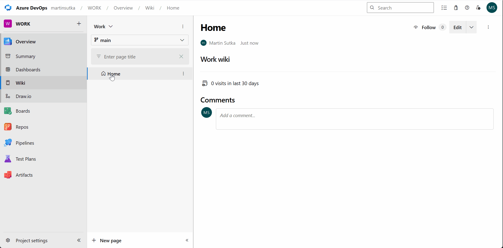

# DrawIo-Devops


# About the extension
This Azure DevOps extension is based on [info-emait/DrawIo](https://github.com/info-emait/DrawIo). It bundles the draw.io editor in the extension package so you can open, edit and commit diagrams directly in Azure DevOps.



# Features
* List and view draw.io files: `.drawio`, `.svg`, `.png` from all project repositories and wikis.
* Create new diagram files.
* Rename existing diagram files.
* History tracking for diagram files.

# Setup
After installing the extension from the Marketplace, you need to enable it in the **Manage features**  section. In order to do so, follow the instructions [here](https://learn.microsoft.com/en-us/azure/devops/project/navigation/preview-features?view=azure-devops).

# How does it work
Draw.io can be used for editing files with `.drawio` extension (native draw.io format). You can also edit `.png` and `.svg` files, if they were saved from draw.io as **Editable Bitmap Image** or **Editable Vector Image**.

# Build and package

## GitHub Actions (no local build required)

The [Build Marketplace VSIX workflow](https://github.com/Yusufmolla/drawio-devops/actions/workflows/package.yml) runs on every push to `main` and can be started manually with **Run workflow**.

1. Create your publisher in the [Marketplace publishing portal](https://marketplace.visualstudio.com/manage).
2. In GitHub, open **Settings → Secrets and variables → Actions → Variables** and create `AZDO_PUBLISHER` with your Marketplace publisher ID. Alternatively, enter the ID in the workflow's `publisher` input when starting a manual run.
3. Open the completed workflow run and download **drawio-devops-vsix** under **Artifacts**.
4. Extract the ZIP and upload its `.vsix` through **New extension → Azure DevOps** in the Marketplace portal.

Without a publisher ID, the workflow builds a test package using `local-drawio-pilot`; rebuild with your own ID before uploading. The manifest is configured for a public listing. This workflow builds the package; Marketplace upload is manual and needs no publishing token in GitHub. For each Marketplace update, increase the version in `package.json` and the root package entries in `package-lock.json` before rebuilding.

## Local build

Requirements: Node.js 22.12 or newer, npm, and Python 3 available as `python`.

```powershell
npm ci
$env:AZDO_PUBLISHER = "your-marketplace-publisher-id"
npm run build
npm run package
```

The build downloads draw.io **32.6.10** from the upstream GitHub release and verifies its SHA-256 checksum. The downloaded `draw-editor.war` is cached locally and excluded from Git. Internet access is required for dependency installation and the first editor download.

`npm run package` creates a `.vsix` in `dist/` and removes the intermediate build files. Upload the VSIX to your Azure DevOps Marketplace publisher. This is separate from publishing the source code on GitHub. `AZDO_PUBLISHER` must match your Marketplace publisher ID; without it, the build uses `local-drawio-pilot`.

The bundled editor uses lockdown mode and a content security policy that restricts external requests. The extension still communicates with Azure DevOps to read and commit diagrams and requires the `vso.code_write` scope. Use repository permissions to control access.

`npm run debug` builds with source maps. `npm run dev` starts Vite, but Azure DevOps SDK features require an Azure DevOps host.

# Project and licenses

This fork is maintained at [Yusufmolla/drawio-devops](https://github.com/Yusufmolla/drawio-devops). Report bugs and feature requests through that repository's Issues.

The original extension's license is preserved in [public/License.md](public/License.md). The bundled draw.io editor has its own [Apache 2.0 license](public/drawio-LICENSE.txt); upstream notices remain included in the editor distribution.
