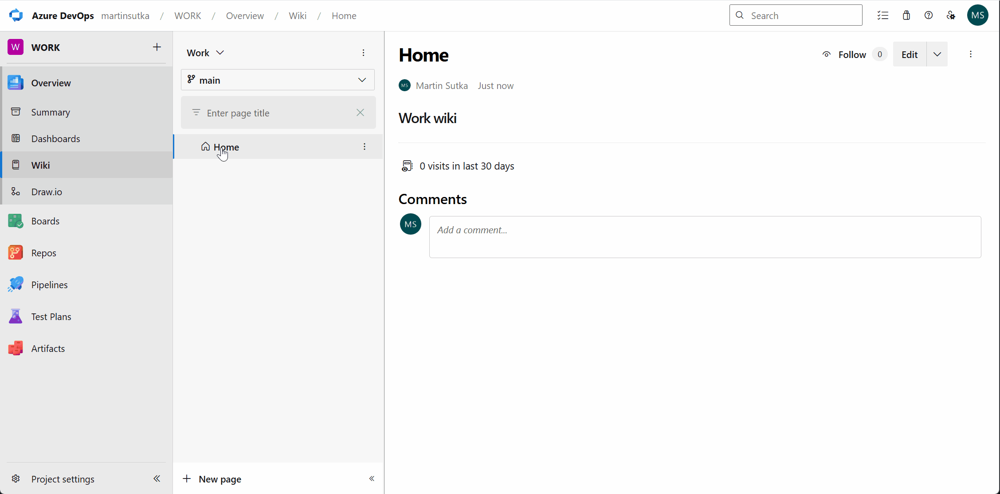

# DrawIo-Devops

# About the extension
This Azure DevOps extension is based on [info-emait/DrawIo](https://github.com/info-emait/DrawIo). It bundles the draw.io editor in the extension package so you can view, create, edit and commit diagrams without leaving the Azure DevOps UI.

# Features
* List and view draw.io files: `.drawio`, `.svg`, `.png` from all project repositories and wikis.
* Create new diagram files.
* Rename existing diagram files.
* History tracking for diagram files.

# Setup
After installing the extension from the Marketplace, you need to enable it in the **Manage features**  section. In order to do so, follow the instructions [here](https://learn.microsoft.com/en-us/azure/devops/project/navigation/preview-features?view=azure-devops).

# How does it work
Draw.io can be used for editing files with `.drawio` extension (native draw.io format). You can also edit `.png` and `.svg` files, if they were saved from draw.io as **Editable Bitmap Image** or **Editable Vector Image**.

# Project
Source code, build instructions and issue tracking are available at [Yusufmolla/drawio-devops](https://github.com/Yusufmolla/drawio-devops).
